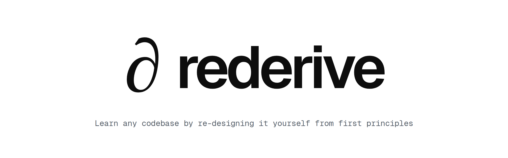
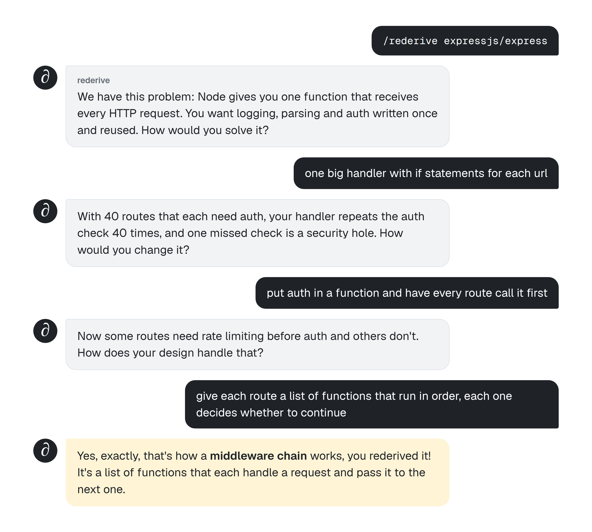

<p align="center">
  <picture>
    <source media="(prefers-color-scheme: dark)" srcset="assets/banner-dark.png" />
    
  </picture>
</p>

<p align="center"><b>An attempt by a frustrated developer to restore humanity's curiosity</b></p>

<p align="center">
  <a href="LICENSE"></a>
  &nbsp;
  <a href="https://agentskills.io"></a>
  &nbsp;
  <a href="#install"></a>
</p>

<p align="center"><sub><a href="#install">Install</a> · <a href="#a-session">A session</a> · <a href="#how-it-works">How it works</a> · <a href="#license">License</a></sub></p>

**rederive** is a skill for coding agents that teaches you a codebase by making you design it yourself from first principles. It only asks you questions to guide you to the right answer, and it won't explain things. We made this on purpose to aim for understanding through derivation, instead of memorizing what the agent says.
## Install

```
npx skills add EricJujianZou/rederive
```

The same command installs it in Claude Code, Codex, Cursor, Gemini CLI, GitHub Copilot, opencode, Windsurf, Amp, Goose and about 15 other agents. It puts the skill in every agent folder it finds in your project. Add `-g` to install it for every project instead. Then type `/rederive` in your agent.

It needs `git`, `bash` and `python3`.

<details>
<summary>Other ways to install</summary>

As a Claude Code plugin:

```
/plugin marketplace add EricJujianZou/rederive
/plugin install rederive@rederive
```

By hand, clone the repo and copy `skills/rederive` into your agent's skills folder, such as `~/.claude/skills/` or `~/.agents/skills/`:

```
git clone https://github.com/EricJujianZou/rederive
cp -r rederive/skills/rederive ~/.agents/skills/
```

</details>

## A session

The start of a session on Express (an example, shortened):

<p align="center">
  <picture>
    <source media="(prefers-color-scheme: dark)" srcset="assets/session-dark.png" />
    
  </picture>
</p>

## Use

```
/rederive                                       # the repo you are in
/rederive ~/code/myapp                          # a local repo
/rederive https://github.com/expressjs/express  # clones it into the current folder
```

Talk to it in plain words. Tell it you're stuck, ask to skip a problem, or say you want to start over.

## How it works

- **It starts from why the project exists.** On your own repo it asks you why you built it. On someone else's repo it works out the original problem and asks how you would solve it.
- **A background agent maps the repo while you answer.** It reads the code, the import links between files and the commits where the design changed. It doesn't trust commit messages, so repos built with AI in a few big commits work too.
- **The map holds 5 to 10 problems** in the order the system would be built, each with its constraints and the real design. It lives in `.rederive/map.md`. Don't open it until you're done, because it has the answers.
- **When you're stuck,** it narrows the problem to a few approaches to choose from. After two wrong answers in a row it offers to sketch the problem for you.
- **It keeps notes on how you did** in `.rederive/log.md`: where you struggled and what you worked out alone. Read it at the end to see what to practice.

Everything stays on your machine. `.rederive/` goes in the repo's local git exclude list, so it never shows up in your commits. rederive sends no telemetry.

## License

MIT
